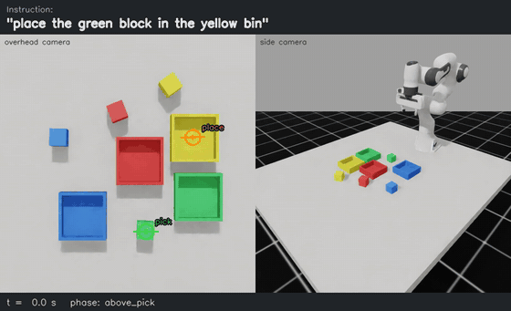
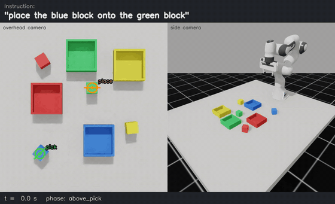
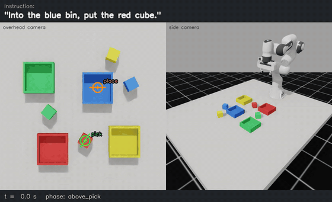
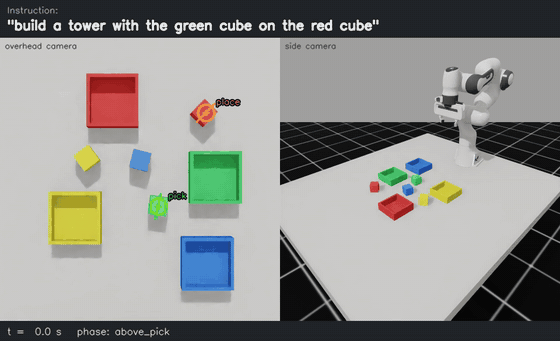
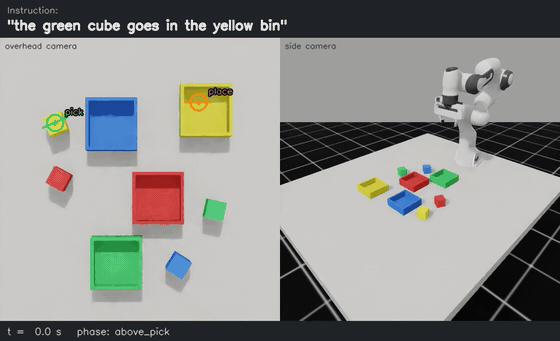
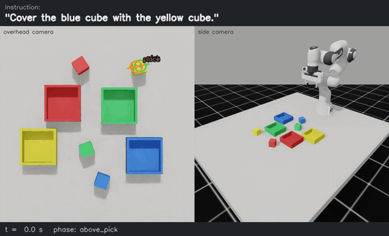
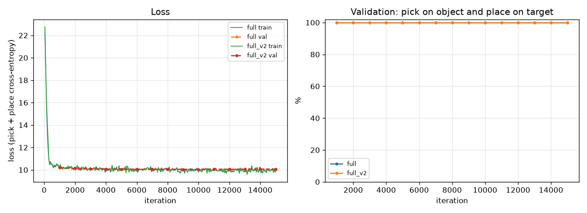

# VisionLang-RobotManip

**Vision-language-guided robotic manipulation** in Isaac Lab.

A Franka Panda arm in Isaac Lab picks up coloured cubes and either drops them into coloured bins or stacks them
on other cubes, following a natural-language instruction such as *"Put the red cube into the blue bin."* or
*"Stack the yellow block on the green block."*

The policy is learned by imitation from a scripted expert. At test time it sees **only** the overhead RGB-D
camera and the instruction text; ground-truth object poses are used only to score the outcome.

## Test videos

Final model on unseen evaluation layouts (1.5× speed). Full-length MP4s are in [`videos/`](videos).

<table>
  <tr>
    <td align="center"><br>
      <em>"place the green block in the yellow bin"</em><br>pick-and-place, seen phrasing: <b>success</b></td>
    <td align="center"><br>
      <em>"place the blue block onto the green block"</em><br>stacking, seen phrasing: <b>success</b></td>
  </tr>
  <tr>
    <td align="center"><br>
      <em>"Into the blue bin, put the red cube."</em><br>pick-and-place, unseen destination-first phrasing: <b>success</b></td>
    <td align="center"><br>
      <em>"build a tower with the green cube on the red cube"</em><br>stacking, unseen phrasing: <b>success</b></td>
  </tr>
  <tr>
    <td align="center"><br>
      <em>"the green cube goes in the yellow bin"</em><br>unseen phrasing: <b>failure</b>, picks the yellow cube</td>
    <td align="center"><br>
      <em>"Cover the blue cube with the yellow cube."</em><br>unseen phrasing: <b>failure</b>, places the cube back on itself</td>
  </tr>
</table>

## Results

Evaluation runs in simulation on layouts drawn from evaluation seed `10000` (training demonstrations use seed
`0`). Every trial is a fresh random arrangement of 4 cubes and 4 bins with random positions and rotations, so
every evaluation layout is unseen. Each suite has 100 trials.

**Final model** (`runs/full_v2`, full output in [results/eval/summary.md](results/eval/summary.md)):

| Suite | Trials | Object | Grasp | Destination | Bin placement | Stacking | Overall | Exec. time (s) |
|---|---|---|---|---|---|---|---|---|
| pick_place | 100 | 100.0% | 100.0% | 100.0% | 100.0% | - | 100.0% | 10.3 |
| stack | 100 | 100.0% | 100.0% | 100.0% | - | 100.0% | 100.0% | 9.9 |
| pick_place_heldout | 100 | 94.0% | 94.0% | 99.0% | 94.0% | - | 94.0% | 10.3 |
| stack_heldout | 100 | 100.0% | 100.0% | 100.0% | - | 100.0% | 100.0% | 9.9 |
| pick_place_reordered | 100 | 100.0% | 100.0% | 100.0% | 100.0% | - | 100.0% | 10.3 |
| stack_reordered | 100 | 99.0% | 90.0% | 87.0% | - | 87.0% | 87.0% | 9.8 |
| **all 600 trials** | 600 | 98.8% | 97.3% | 97.7% | 98.0% | 95.7% | **96.8%** | 10.1 |

Policy inference (CLIP + network, batched) takes about 4 ms per instruction on an RTX 5000 Ada; execution time
is dominated by the arm motion (about 10 s of simulated time per task).

* **Object**: the predicted pick point lies on the top face of the instructed cube.
* **Grasp**: the instructed cube was picked up and still held after lifting.
* **Destination**: the predicted place point lies inside the instructed bin / on the instructed cube.
* **Bin placement** / **Stacking**: the cube ended at rest inside the instructed bin / on top of the instructed
  cube, with no other cube disturbed by more than 1 cm.
* **Overall**: complete task success (all of the above).
* **Exec. time**: simulated time from the first motion command until the arm is back at its ready pose.

Suites:

* `pick_place`, `stack`: instruction phrasings that appear in the training demonstrations (new layouts).
* `*_heldout`: phrasings that never appear in training (e.g. *"Transfer the red cube to the blue bin."*).
* `*_reordered`: unseen phrasings that name the destination *before* the cube (e.g. *"Cover the blue cube
  with the green cube."*). A model that just treats the first colour as the object fails here.

### What the stress test showed

The first model (`runs/full`, [results/eval_v1/summary.md](results/eval_v1/summary.md)) was trained only on
phrasings that name the cube first. It was perfect on seen and held-out phrasings, but the reordered suites
exposed a shortcut: it had learned "first colour = cube to move".

| Overall success | Seen | Held-out | Reordered pick-place | Reordered stacking | All 600 |
|---|---|---|---|---|---|
| Baseline (`runs/full`) | 100% | 100% | 24% | 0% | 70.7% |
| Final (`runs/full_v2`) | 100% | 97% | 100% | 87% | 96.8% |

For example, asked to *"Cover the blue cube with the green cube."* the baseline put the blue cube on the green
one (`videos/eval_v1/stacking/failure/`). The final model adds three destination-first phrasings per task to
the training set (e.g. *"Use the {dst} bin for the {obj} cube."*, *"the {dst} block goes under the {obj}
block"*). None of them overlaps the reordered test phrasings, which stay unseen. Everything else (data size,
seeds, network, schedule) is identical.

The remaining failures are all language generalisation on unseen phrasings. Grasping and placing themselves
never failed once the right poses were predicted (581 of 581 such trials succeeded, with no controller
timeouts):

* `pick_place_heldout`: all 6 failures are *"the {obj} cube goes in the {dst} bin"*, where the model picked
  the cube with the bin's colour. A sentence that starts with "the {colour} ..." now looks like the new
  training phrasing *"the {dst} container needs the {obj} block"*.
* `stack_reordered`: all 13 failures are *"Cover the {dst} cube with the {obj} cube."*. The model picks the
  right cube but predicts the place point on that same cube instead of the one to cover.

With only 11 pick-and-place and 10 stacking training templates the model still keys on surface patterns; a
larger and more varied set of training phrasings is the obvious next step.

### Scripted expert (upper bound)

The expert uses ground-truth poses and the same IK executor as the policy. It is only used to generate
demonstrations and to check that the controller is reliable.

| Stage | Setting | Trials | Grasp | Placement | Success | Exec. time (s) |
|---|---|---|---|---|---|---|
| 1 | 1 cube, 1 bin, fixed positions (±1 cm jitter) | 20 | 100% | 100% | 100% | 10.0 |
| 2 | 4 cubes, 4 bins, random layouts, pick-and-place | 50 | 100% | 100% | 100% | 10.2 |
| 3 | 4 cubes, 4 bins, random layouts, stacking | 50 | 100% | 100% | 100% | 10.0 |

### Videos

Each evaluation keeps up to three success and three failure videos per suite. Every video shows the
instruction, the overhead and side cameras, the predicted pick and place poses (markers with the finger-closing
direction), the current controller phase and a SUCCESS / FAILURE banner at the end.

| Folder | Contents |
|---|---|
| `videos/pick_place/{success,failure}` | final model, pick-and-place suites |
| `videos/stacking/{success,failure}` | final model, stacking suites |
| `videos/eval_v1/...` | baseline model (same folder structure) |
| `videos/instructions/` | single instructions run with `run_instruction.py` (5 of 5 succeeded) |
| `videos/expert/stage{1,2,3}` | scripted expert |
| `videos/demos/` | randomly chosen training demonstrations |

The main evaluation records 6 of the 50 parallel environments per batch, and none of the final model's failures
fell in those. The failure videos come from a replay of the two suites with failures (`pick_place_heldout`,
`stack_reordered`) with every environment recorded (`--record 50`, summary in `results/eval_replay/`). Each
trial's layout and instruction depend only on the evaluation seed, the suite and the batch, so the replay runs
the same 200 trials and reproduces the same success rates (94% and 87%). The physics is not bit-exact across
runs, so the secondary metrics can differ by a trial or two.

## Method

### Scene

* Franka Panda on a table, 4 cubes (4.5 cm, red/blue/green/yellow) and 4 open bins of the same colours.
* Layouts are sampled with random positions and yaw in a 42 cm × 42 cm region, with minimum gaps so the open
  gripper fits between objects.
* An overhead RGB-D camera (256 × 256) looks straight down; a perspective side camera is used only for videos.
* Before observing, the arm folds back to a ready pose so it hides nothing from the overhead camera.

### Observation: top-down maps

The overhead RGB-D image is back-projected with the known camera intrinsics and extrinsics into a
160 × 160 orthographic map of the workspace (3.5 mm per cell) with 4 channels: RGB colour and height above
the table. These maps are all the policy sees of the world.

### Action: pick and place poses

The policy outputs two poses, each a cell in the map plus one of 8 gripper yaw bins (11.25° apart, covering
90° because cubes and bins are 90° symmetric):

* **pick**: where to grasp and how to rotate the fingers,
* **place**: where to release.

The gripper height is read from the height map at the predicted cell (cube top for the grasp, bin floor or cube
top for the release). A differential-IK controller then executes the motion: approach above → descend → close →
lift → carry at a safe height → descend → open → retreat → return to the ready pose. A failed grasp
(fingers closed on nothing) is detected from the finger width and aborts the place.

### Network

* **Language and semantics**: a frozen CLIP ViT-B/16. The text encoder gives per-word token features and a
  sentence embedding; the image encoder gives a 14 × 14 grid of patch features of the colour map.
* **Spatial stream**: a small residual CNN encodes the colour + height map down to 20 × 20.
* **Fusion**: at 20 × 20, the spatial features and the (resized) CLIP patch features are combined into tokens.
  Separate pick and place heads each run 2 transformer blocks (self-attention over the map, cross-attention to
  the instruction's word tokens).
* **Decoder**: upsamples back to 160 × 160 with skip connections and FiLM conditioning on the sentence
  embedding, and outputs 8 yaw logits per cell for each head.
* 9.8 M trainable parameters (CLIP is frozen).

### Training

* Demonstrations: 8000 scripted-expert labels on random layouts (half pick-and-place, half stacking) with the
  training instruction phrasings. Each demo stores the RGB-D image, the maps, the instruction and the expert's
  pick/place cells.
* Loss: cross-entropy over all cells × yaw bins, with targets smoothed by a small spatial Gaussian and a circular
  yaw Gaussian (so the loss does not go to zero; its floor is the target entropy).
* Augmentation: random 90° rotations, mirror flips (yaw bins mirrored too), and shifts of up to 8 cells,
  applied identically to maps and labels.
* AdamW, learning rate 1e-4 with warm-up and cosine decay, batch 32, 15000 iterations, bfloat16 autocast,
  about 45 minutes on one RTX 5000 Ada. Validation accuracy (predicted pick on the instructed cube and place
  on the instructed target, on 5% held-out demos) is already 100% at the first check (iteration 1000), so the
  final checkpoint (`last.pt`) is used. Validation uses training phrasings only, which is why it could not
  reveal the word-order shortcut; the reordered evaluation suites did.



## Setup

Tested with Ubuntu 22.04, an RTX 5000 Ada (32 GB, driver 570), Isaac Sim 4.5.0, Isaac Lab 2.1 and
Python 3.10.

1. Install Isaac Sim 4.5 and Isaac Lab 2.1 in a Python 3.10 virtual environment following the Isaac Lab
   installation guide (pip installation).
2. Install the remaining dependencies in the same environment:

   ```bash
   pip install -r requirements.txt
   ```

3. The CLIP weights (`openai/clip-vit-base-patch16`) are downloaded from the Hugging Face Hub on first use.

All Isaac scripts take `--headless`. On a multi-GPU machine select the GPU with `CUDA_VISIBLE_DEVICES`.

## Usage

```bash
# 0. unit tests (no simulator needed)
python -m pytest -q tests

# 1. scene and camera check: images and map accuracy in results/smoke_scene/
python scripts/smoke_scene.py --headless

# 2. scripted expert reliability (stages 1-3), videos in videos/expert/
python scripts/run_expert.py --headless --stage 1 --trials 20 --videos 3
python scripts/run_expert.py --headless --stage 2 --trials 50 --videos 3
python scripts/run_expert.py --headless --stage 3 --trials 50 --videos 3

# 3. demonstrations (labels only, about 75 s for 8000 with 100 parallel environments)
python scripts/generate_demos.py --headless --num_demos 8000 --num_envs 100 --out data/demos_train_v2.h5
#    optional: execute a pilot set with the expert and record random demos
python scripts/generate_demos.py --headless --num_demos 200 --execute --videos 8 --out data/demos_pilot.h5

# 4. training (TensorBoard logs and checkpoints in runs/full_v2/, about 45 min)
python scripts/train.py --data data/demos_train_v2.h5 --run full_v2 --set train.iterations=15000

# 5. evaluation, 6 suites x 100 trials (about 30 min):
#    results/eval/summary.{json,md}, trials.jsonl, videos/{pick_place,stacking}/{success,failure}/
python scripts/evaluate_policy.py --headless --checkpoint runs/full_v2/last.pt --trials 100
#    replay chosen suites with every environment recorded (needs about 26 GB of GPU memory for 50 envs)
python scripts/evaluate_policy.py --headless --checkpoint runs/full_v2/last.pt --trials 100 \
    --suites pick_place_heldout stack_reordered --record 50 --out results/eval_replay

# 6. one instruction on a random layout -> videos/instructions/
python scripts/run_instruction.py --headless --checkpoint runs/full_v2/last.pt \
    --instruction "Into the green bin, put the yellow cube." --layout_seed 20003

# training curves
python scripts/plot_training.py runs/full runs/full_v2 --out docs/training_curves.png
```

The baseline in the comparison table was produced the same way, with the training phrasings of
`vlamanip/language/templates.py` minus the three destination-first ones per task.

Configuration lives in `configs/default.yaml`; any value can be overridden on the training command line with
`--set section.key=value`.

## Repository layout

```
configs/default.yaml        scene, camera, controller, success criteria, model, training, seeds
vlamanip/
  sim/                      Isaac Lab scene, assets, random layouts, rollout loop
  perception/               RGB-D -> top-down colour/height maps; ground-truth reference raster
  control/                  differential-IK executor (pick/place state machine)
  expert/                   scripted expert (ground-truth poses -> pick/place actions)
  language/                 instruction templates (train / held-out / reordered) and parser
  data/                     HDF5 demo storage, dataset, augmentation
  models/                   frozen CLIP encoder, policy network, losses
  policy.py                 inference: maps + text -> pick/place poses
  evaluation/               success judging
  viz/                      video composition and recording
scripts/                    entry points (see Usage)
tests/                      unit tests
results/                    evaluation and expert summaries
videos/                     recorded episodes
```

## Limitations

* Instructions are generated from templates over four colours; the policy has not been tested on free-form
  language beyond the held-out and reordered phrasings.
* The task is single-step (one pick, one place) and open-loop after the observation: the policy predicts both
  poses from the first image and does not re-plan.
* Everything is in simulation; no sim-to-real transfer is attempted.

## Third-party software

See [THIRD_PARTY_NOTICES.md](THIRD_PARTY_NOTICES.md). No external code was copied into this repository.
